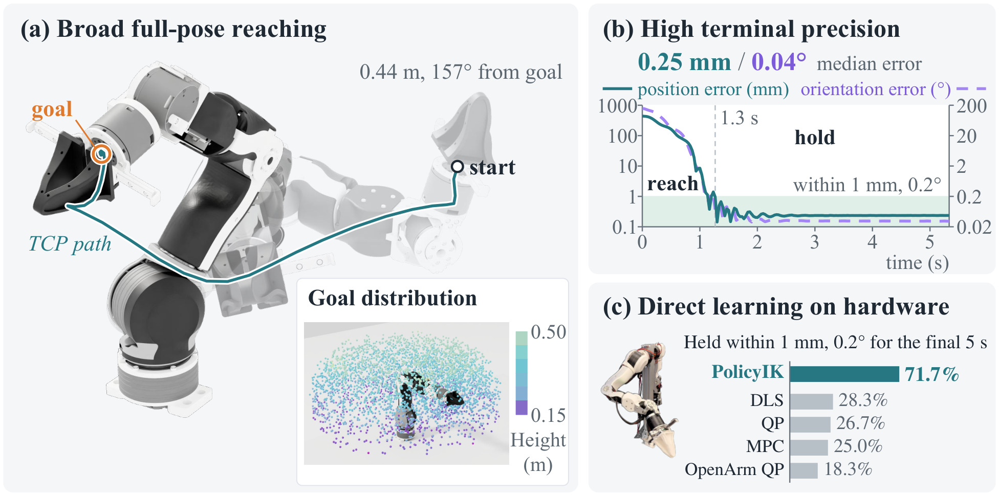

<div align="center">

# PolicyIK: High-Precision Inverse Kinematics for Robot Arms with Reinforcement Learning

Yuhan Liu<sup>1*</sup>, Xinqi Liu<sup>1*</sup>, Zixuan Dong<sup>1*</sup>, Keith W. Ross<sup>2</sup>, Shenji Wan<sup>1</sup>

<sup>1</sup>New York University &nbsp; <sup>2</sup>New York University Abu Dhabi &nbsp; <sup>*</sup>Equal contribution

[](https://arxiv.org/abs/2611.05372)
[](https://tinaliu0123.github.io/PolicyIK/)
[](https://x.com/l_yuhan7272/status/2118366838719422651)

</div>

<p align="center">
  
</p>

PolicyIK is a goal-conditioned reinforcement learning policy for high-precision inverse kinematics (IK) of robot arms. In simulation and when trained directly on a physical OpenArm, it reaches and holds full end-effector poses within 1 mm and 0.2° on more tasks than classical IK controllers.

> **Community reimplementation (unofficial):** a from-scratch MuJoCo port on a 6-DoF UR5e — CPU (Stable-Baselines3) and GPU (MJX + Brax), reproducing the classical IK baselines — is available at [VatsalyaBhadaurya/PolicyIK](https://github.com/VatsalyaBhadaurya/PolicyIK).

## 📝 Table of Contents

- [Project Structure](#project-structure)
- [Simulation](#simulation)
  - [Installation](#installation)
  - [Data and Checkpoints](#data-and-checkpoints)
  - [Quick Start](#quick-start)
  - [Training](#training)
  - [Evaluation](#evaluation)
- [Real Robot](#real-robot)
- [Citation](#citation)

## Project Structure

```
PolicyIK/
├── simulation/
│   ├── policyik_sim/      # Isaac Lab task, training, evaluation and metrics
│   ├── scripts/
│   ├── data/              # source set, training pools and evaluation tasks
│   └── checkpoints/       # released policies
├── hardware/
│   ├── policyik_hw/       # arm env, ROS 2 interface, training with HER and demonstrations, evaluation
│   ├── flash_rl/          # FlashSAC
│   ├── ros2/              # ROS 2 package that starts the arm
│   ├── data/              # evaluation tasks, demonstrations and task pool
│   ├── scripts/
│   └── config.yaml        # the training recipe
└── requirements/
```

## Simulation

In simulation, we train PolicyIK with PPO in Isaac Lab and evaluate it on 4,120 held-out tasks. The commands in this section run from `simulation/`.

### Installation

```bash
git clone https://github.com/Tinaliu0123/PolicyIK.git
cd PolicyIK/simulation
conda create -n policyik python=3.11
conda activate policyik
bash install.sh
```

> [!NOTE]
> The scripts set `OMNI_KIT_ACCEPT_EULA=YES`, which accepts the [NVIDIA Omniverse license](https://docs.omniverse.nvidia.com/install-guide/latest/common/NVIDIA_Omniverse_License_Agreement.html) of Isaac Sim.

### Data and Checkpoints

The data and the checkpoints are part of the repository. All poses are end-effector poses of `openarm_hand` in the robot base frame, with quaternions in (w, x, y, z) order.

| File | Content |
|---|---|
| `data/source_set.npz` | 200,000 joint configurations `q` with their poses `ee_pos`, `ee_quat` and the `floor_contact` and `self_collision` labels |
| `data/train_start_pool.npz` | training start configurations |
| `data/train_goal_pool.npz` | training goals in the deployment workspace |
| `data/eval_tasks.npz` | 4,120 evaluation tasks `q_start`, `goal_pos`, `goal_quat` |
| `checkpoints/policyik_s{1,2,3}.pth` | released policies, each an exponentially weighted average of the last 20 checkpoints of one training run |

### Quick Start

```bash
bash scripts/evaluate.sh 1 checkpoints/policyik_s1.pth
```

This evaluates a released policy with a single attempt and with the deployment protocol, writes the rollouts to `outputs/eval/s1/`, and prints the metrics.

### Training

```bash
bash scripts/train.sh 1
```

This trains a policy for 13,000 PPO epochs and averages its last 20 checkpoints with exponential weights into `logs/rl_games/policyik_s1/checkpoint_average.pth`.

### Evaluation

```bash
for s in 1 2 3; do bash scripts/evaluate.sh $s checkpoints/policyik_s$s.pth; done
python -m policyik_sim.metrics --seed_dir outputs/eval/s1 --seed_dir outputs/eval/s2 --seed_dir outputs/eval/s3
```

This evaluates the three released policies and reports the metrics over them. Without a checkpoint argument, `bash scripts/evaluate.sh 1` evaluates the policy written by `bash scripts/train.sh 1`. A task succeeds when the mean position and orientation errors over the final second are below 1 mm and 0.2° (strict) or 1 cm and 2° (coarse).

## Real Robot

On the real robot, we train PolicyIK directly on a physical [OpenArm](https://docs.openarm.dev/1.0/) with FlashSAC and Hindsight Experience Replay (HER), and evaluate it on 60 fixed tasks. See [hardware/README.md](hardware/README.md) for the installation, the robot setup, training and evaluation.

## Citation

If you find this work useful, please cite our paper:

```bibtex
@article{liu2026policyik,
  title   = {PolicyIK: High-Precision Inverse Kinematics for Robot Arms with Reinforcement Learning},
  author  = {Liu, Yuhan and Liu, Xinqi and Dong, Zixuan and Ross, Keith W. and Wan, Shenji},
  journal = {arXiv preprint arXiv:2611.05372},
  year    = {2026}
}
```
